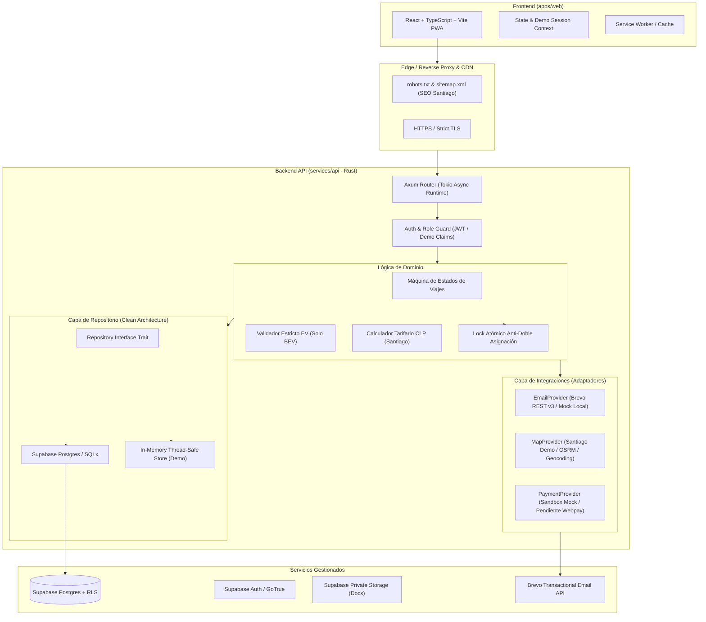
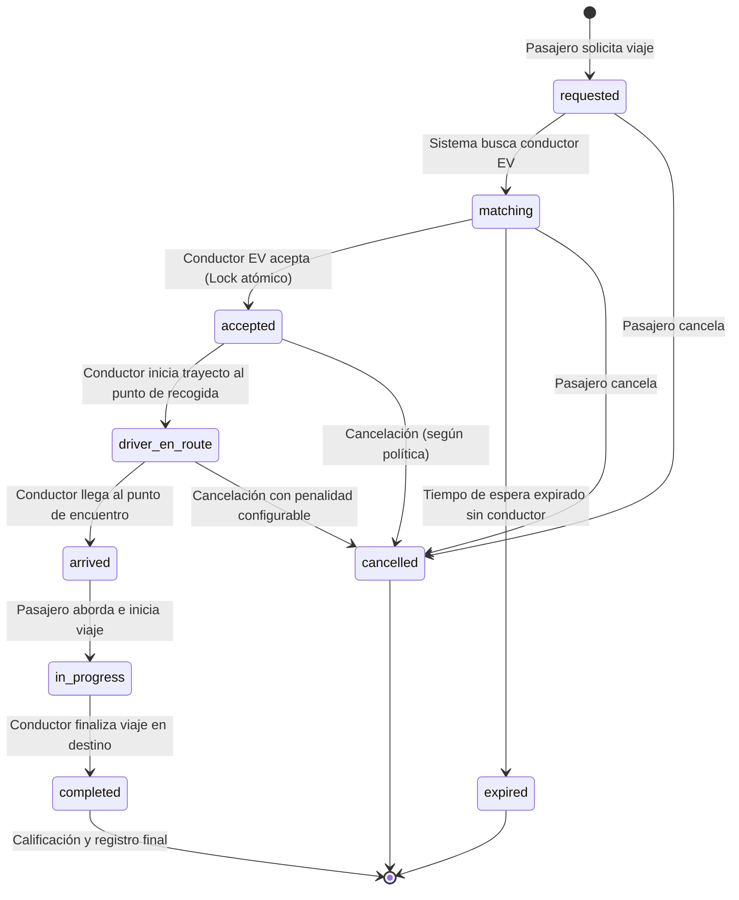

# Arquitectura y Diseño del Sistema Zuvio

## 1. Visión del Producto
**Zuvio** (“*Muévete a tu manera*”) es una plataforma de movilidad urbana (ride-hailing) concebida para la Región Metropolitana de Santiago de Chile. Su diferenciador central radica en operar exclusivamente con vehículos **100% eléctricos (BEV - Battery Electric Vehicles)**, ofreciendo traslados silenciosos, eficientes y con un compromiso riguroso hacia la calidad, accesibilidad y seguridad urbana.

---

## 2. Diagrama de Arquitectura de Alto Nivel

---

## 3. Máquina de Estados de Viajes (Ride State Machine)

El ciclo de vida del viaje se modela con transiciones explícitas, marcas de tiempo y validación de actor autorizado en el servidor:

### Matriz de Transiciones y Permisos
| Estado Origen | Estado Destino | Actor Autorizado | Regla de Negocio Crítica |
|---|---|---|---|
| `none` | `requested` | Pasajero | Origen y destino válidos dentro del Gran Santiago. Estimación previa obligatoria. |
| `requested` | `matching` | Sistema / Pasajero | Búsqueda activa de conductores en línea con auto eléctrico aprobado. |
| `matching` | `accepted` | Conductor | Conductor debe estar aprobado, en línea, con EV activo y sin viajes en curso. |
| `accepted` | `driver_en_route`| Conductor | Notifica al pasajero; activa cálculo de ETA en tiempo real. |
| `driver_en_route`| `arrived` | Conductor | Se notifica llegada al punto de encuentro en Santiago. |
| `arrived` | `in_progress` | Conductor | Inicia trayecto con pasajero a bordo. |
| `in_progress` | `completed` | Conductor | Se calcula tarifa final CLP; se genera evento de completitud. |
| `requested`/`matching`/`accepted`/`driver_en_route` | `cancelled` | Pasajero / Conductor / Admin | Aplica reglas de cobro por cancelación tardía si superó ventana de tolerancia. |
| `matching` | `expired` | Sistema | Cuando ningún conductor acepta en la ventana de tiempo (ej. 3 min). |

---

## 4. Modelo de Amenazas y Seguridad (Threat Modeling)

1. **Doble Asignación de Viaje (Race Conditions)**:
   - *Amenaza*: Dos conductores aceptan la misma solicitud simultáneamente.
   - *Mitigación*: Transacción atómica / Mutex con comprobación condicional (`UPDATE rides SET status = 'accepted', driver_id = $1 WHERE id = $2 AND status = 'matching'`). Si las filas afectadas son 0, la solicitud ya fue tomada por otro conductor.
2. **Fraude de Vehículo no Eléctrico**:
   - *Amenaza*: Un conductor registra un vehículo a combustión (híbrido o gasolina) haciéndolo pasar por eléctrico.
   - *Mitigación*: Validación en múltiples capas. En base de datos: restricción `CHECK (propulsion = 'BEV')`. En lógica de negocio: catálogo de marcas/modelos EV homologados por el Ministerio de Transportes y Telecomunicaciones de Chile (MTT/3CV) y revisión manual obligatoria por el equipo de Operaciones antes de la activación.
3. **Filtro de Datos Personales y Documentos Privados**:
   - *Amenaza*: Exposición pública de licencias de conducir, certificados de antecedentes o números de contacto.
   - *Mitigación*: Bucket privado en Supabase Storage con generación de URLs firmadas de corta duración (TTL 10 minutos). Políticas estrictas RLS en `driver_documents` restringidas a `owner` y `admin`.
4. **Spoofing y Rastreo Excesivo de Ubicaciones**:
   - *Amenaza*: Espionaje de rutas o retención indefinida de geolocalizaciones precisas.
   - *Mitigación*: Principio de minimización: las coordenadas solo se transmiten durante estados activos (`driver_en_route`, `arrived`, `in_progress`). Política de retención automática que trunca o anonimiza trazas tras 30 días.

---

## 5. Supuestos de Diseño y Modo Demo
- **Entorno Local y Demo Mode**: Para facilitar la ejecución inmediata sin depender de variables externas o claves privadas de terceros, el backend y frontend cuentan con **Modo Demo transparente**.
  - Si no se configuran variables de Supabase o Brevo, el sistema utiliza el repositorio en memoria y el proveedor de correos mock (con salida formateada en consola y visualizador).
- **Tarifas y Moneda**: Moneda oficial en CLP (Pesos Chilenos) sin decimales.
  - Tarifa base: $1.400 CLP
  - Costo por kilómetro: $650 CLP
  - Costo por minuto: $150 CLP
  - Tarifa mínima de viaje: $3.000 CLP
  *(Todos los valores están parametrizados en configuración y marcados como sujetos a confirmación comercial).*

